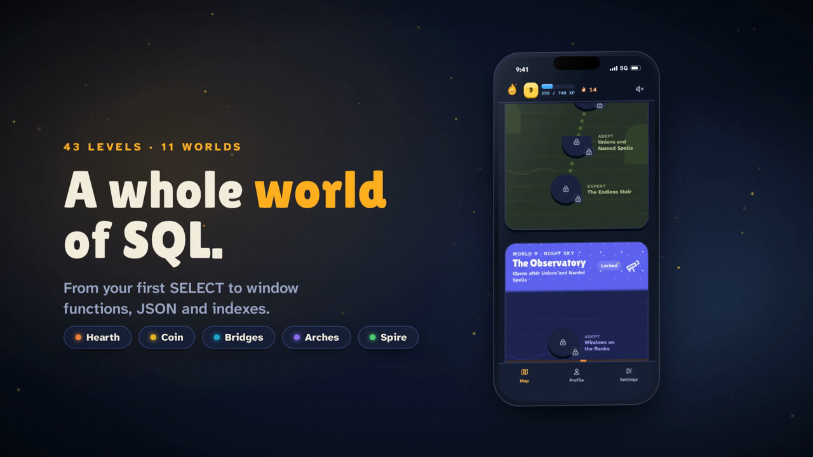
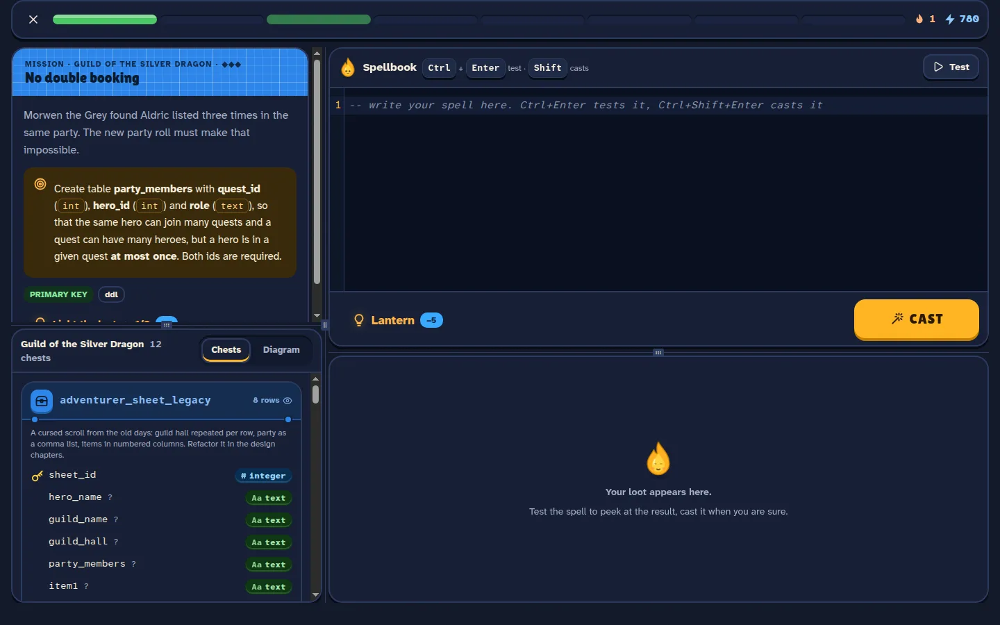
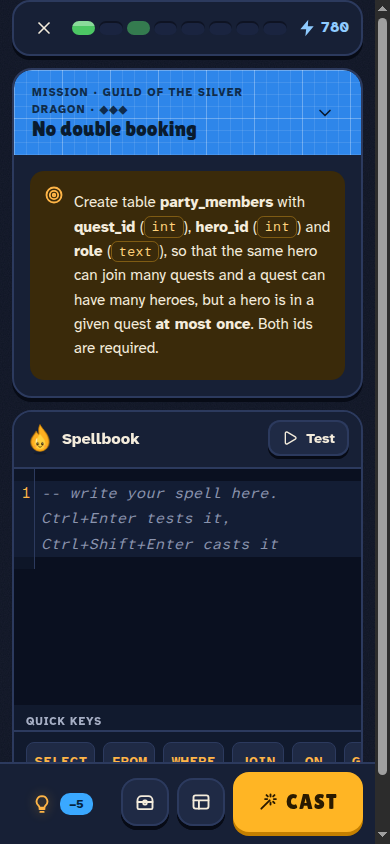

<div align="center">


# SQL Quest

**Learn SQL by playing.** A free, open source game that teaches real PostgreSQL, from your first `SELECT` to window functions, JSON, pgvector and query plans.

[**Play it now**](https://web-production-e47e5.up.railway.app) · [Watch the demo](#demo) · [Run it yourself](#run-it-locally) · [Contribute a level](CONTRIBUTING.md)

[](https://github.com/abdelmounaimam/sql-quest/actions/workflows/ci.yml)
[](LICENSE)


</div>

## Demo

[](https://github.com/abdelmounaimam/sql-quest/releases/download/v1.0.0/sql-quest-demo.mp4)

<p align="center"><em>32 second tour. Click the image to watch the video.</em></p>

## What it is

SQL Quest is a map of 43 levels spread over 11 worlds, covering 199 concepts. Each level is a short lesson, a set of missions and a boss. Every query you write runs against a **real PostgreSQL 18 database inside your browser** (via [PGlite](https://pglite.dev)), so what you learn is exactly what you will type at work.

- **Real Postgres, zero setup.** No server, no account, no install. The database runs in a Web Worker and the app works offline as a PWA.
- **Six story datasets.** A space port, an adventurers' guild, a dungeon, an inn, a library and a bard's catalogue. Missions come from characters of each world instead of `table1` and `foo`.
- **Graded like a teacher would.** The checker compares results, column names, ordering, table state after `INSERT`/`UPDATE`/`DELETE`, schema after DDL, expected error codes and even plan shapes. Wrong answers get a diff and a targeted hint, not just "incorrect".
- **Adaptive progression.** Mastery is tracked per concept. Stars, XP, combos and streaks reward you, and a gate asks for proof before the boss when a concept is still shaky.
- **Made for phones too.** On mobile you build queries from a word bank of tokens, no typing on glass required. On desktop you get a full CodeMirror editor with autocomplete from the live schema.
- **Goes deep.** Joins, subqueries, CTEs and recursion, window functions, transactions and `MERGE`, DDL and constraints, normalization, JSON/JSONB, ranges and arrays, full text search, pgvector similarity search, `EXPLAIN`, indexes, MVCC, PL/pgSQL, row level security.

<table>
  <tr>
    <td width="68%"></td>
    <td></td>
  </tr>
</table>

## Curriculum

| World | Topics |
|---|---|
| 1 · The Starport Docks | `SELECT`, `WHERE`, `NULL` and three valued logic, sorting and paging |
| 2 · The Counting House | Expressions, casts, text and regex, dates, aggregates and `GROUP BY` |
| 3 · The Jump Gates | Keys, inner, outer, self and non equi joins, fan-out |
| 4 · The Nested Catacombs | Subqueries, `EXISTS` and anti joins, set operations, CTEs, recursion |
| 5 · The Observatory | Window functions, top N per group, `LATERAL`, gaps and islands, grouping sets |
| 6 · The Forge | `INSERT`, `UPDATE`, `DELETE`, transactions, upserts and `MERGE`, isolation levels |
| 7 · The Architect's Tower | DDL, constraints, normalization, views, catalog introspection, design antipatterns |
| 8 · The Alchemist's Vault | Numeric precision, enums, arrays, JSON and JSONB, time zones, ranges |
| 9 · The Oracle's Library | Full text search, trigrams, pgvector similarity search |
| 10 · The Clockwork Engine | `EXPLAIN`, index types, why the planner skips your index, MVCC, partitioning |
| 11 · The Astral Spire | Functions and PL/pgSQL, triggers, roles and row level security |

The full blueprint lives in [`docs/levels/level-map.md`](docs/levels/level-map.md) and the pedagogy in [`docs/research/curriculum.md`](docs/research/curriculum.md).

## Run it locally

Requirements: **Node.js 22.13 or newer** (the server uses `node:sqlite`) and **pnpm 10** (`corepack enable` sets it up).

```bash
git clone https://github.com/abdelmounaimam/sql-quest.git
cd sql-quest
pnpm install
pnpm dev
```

Open http://localhost:3000. Progress is stored in your browser first and synced to a small SQLite file in `.data/` when the server is reachable.

### Scripts

| Command | What it does |
|---|---|
| `pnpm dev` | Dev server on port 3000 |
| `pnpm build` then `pnpm start` | Production build and Node server (`.output/`) |
| `pnpm test` | Unit tests (Vitest) |
| `pnpm check` | Lint and format check (Biome) |
| `pnpm validate:content` | Runs every lesson, solution and wrong answer against PGlite to prove each level is solvable and fairly graded |

## Self-hosting

The production build is a self-contained Node server. The only state is one SQLite file holding anonymous profiles, progress and the leaderboard. Point `SQL_QUEST_DB` at a persistent path (see [`.env.example`](.env.example)).

**Docker**

```bash
docker build -t sql-quest .
docker run -p 3000:3000 -v sql-quest-data:/data sql-quest
```

**Railway** (what the public instance uses): `railway.json` is included. Create a service from this repo, attach a volume at `/data` and set `SQL_QUEST_DB=/data/sql-quest.db`.

**Anything else that runs Node 22**: `pnpm build && pnpm start`. The server listens on `PORT` (default 3000).

## How it works

```
src/
  content/          43 chapters, 6 datasets, the concept catalog and the content contract (types.ts)
  engine/sql/       PGlite in a Web Worker, snapshots and reset between attempts
  engine/checker/   grading: result sets, state, schema, errors, plans
  engine/adaptive/  mastery, stars, XP, gates and recommendations
  game/             client store, progress and offline-first sync
  components/game/  map, lesson player, missions, SQL editor and word bank
  routes/           TanStack Router file routes
  server/           server functions and the SQLite store
scripts/            content validator and per-chapter negative cases
docs/               curriculum research, level blueprints, design direction
```

Built with [TanStack Start](https://tanstack.com/start) (Router, Query, DB, Form, Store), React 19, Tailwind CSS v4, [shadcn/ui](https://ui.shadcn.com), [PGlite](https://pglite.dev) with pgvector, CodeMirror 6 and Biome.

## Contributing

Bug reports, typo fixes, new missions and whole new chapters are welcome. Content is plain TypeScript checked by a validator, so you can write a level without touching the UI. Start with [CONTRIBUTING.md](CONTRIBUTING.md).

## License

Code and content are released under the [MIT License](LICENSE). Fonts are bundled from Fontsource under the SIL Open Font License.

Made by [Abdelmounaim Ammari](https://abdelmounaimammari.me).
